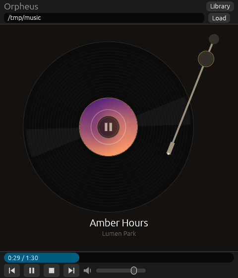
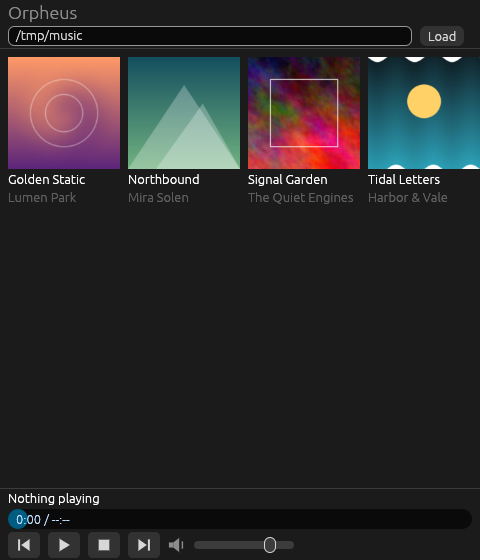
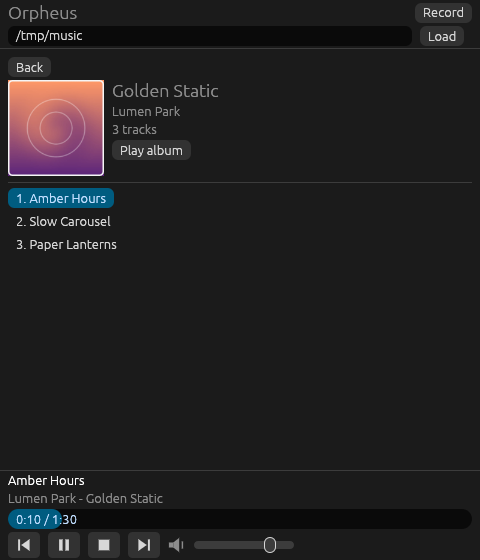
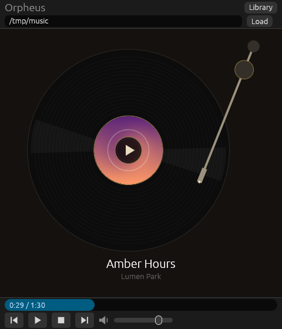

# Orpheus

A minimal, lightweight desktop music player written in Rust (`egui`/`eframe` GUI, `rodio` audio).

<p align="center">
  
</p>

## Screenshots

<table>
  <tr>
    <td align="center"><br><sub><b>Library</b> – albums grouped from your tags, with cover art</sub></td>
    <td align="center"><br><sub><b>Album</b></sub></td>
  </tr>
  <tr>
    <td align="center"><br><sub><b>Record view</b> – spinning at 33 ⅓ rpm, tonearm tracks progress</sub></td>
    <td align="center"><br><sub><b>Paused</b></sub></td>
  </tr>
</table>

> Screenshots were taken with a small demo library of generated tracks and artwork.

## Features

- Library panel: a full-height panel that slides in from the left (library button next to the title, **×** or Esc to close). The vinyl player stays usable beside it. In windows narrower than 700 px the panel covers the whole window.
- Music folder shown at the top of the library panel with a **Change** button (type or paste a path, Enter to open, Esc to cancel); remembered between launches.
- Reads title, artist, album and track number tags; tracks are grouped by album and ordered by track number (untagged files are kept, listed by file name under "Unknown Album").
- Album grid with cover art (embedded artwork, or a `cover.jpg`/`cover.png`/`folder.jpg`/`folder.png` file when the folder holds a single album); the album that is playing is framed in gold. Select an album to see its tracks, then pick a track or **Play album**.
- Vinyl player: a record with the album art as its label, turning at 33 1/3 rpm while playing. Title and artist are shown below.
- Draggable tonearm: lift the needle off the record to pause, put it back on the record to resume from the same spot. The arm moves only along its arc, and the needle creeps inward as the track plays.
- Large previous and next buttons on either side of the record; volume slider at the bottom.
- Plays an album in order and stops after its last track; previous/next stay within the album.
- Dark theme, no network access, no telemetry.

## Supported platforms

Linux, Windows and macOS. CI currently runs on Linux only.

## Supported audio formats

MP3, WAV, FLAC and OGG (Vorbis). Only the selected directory is scanned, not its subdirectories.

## Prerequisites

- Stable Rust toolchain (`rustup`).
- Linux: ALSA development headers and `pkg-config`
  (Debian/Ubuntu: `sudo apt install libasound2-dev pkg-config`).

## Build

```sh
cargo build --release
```

## Run

```sh
cargo run --release
```

Open the library (button at the top left), click **Change**, type or paste the path of your music directory and press **Open** (or Enter).
Settings are stored as `config.toml` in the OS configuration directory.

## Test

```sh
cargo test --all-targets
```

Tests need no audio hardware or music files.
